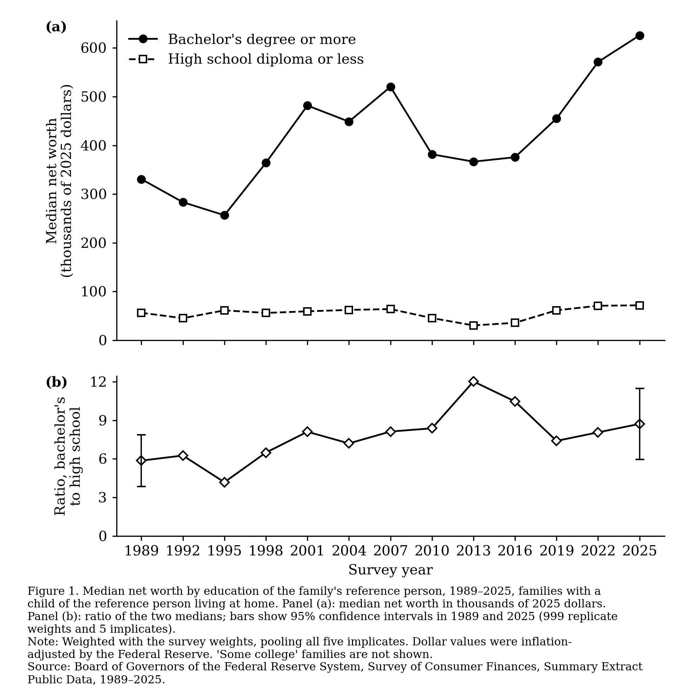

# Wealth by parents' education, 1989–2025

POLISCI 158, Section Assignment 3, **Option B**: the lab's demo figure, family
wealth by parents' education from the Federal Reserve's Survey of Consumer
Finances (SCF), 1989 to the latest survey (2025).



**Question.** How has the wealth gap between families with college-educated
parents and families whose parents have a high-school education or less changed
since 1989?

**Answer, in short.** The typical (median) family with children headed by a
college graduate had $331k in net worth in 1989 and $626k in 2025 (2025
dollars). The typical family headed by someone with a high-school diploma or
less had $56k and $72k. The college family went from about 6 times as wealthy to
about 9 times. The ratio peaked at 12 in 2013, after the Great Recession hit
the high-school group hardest. The figure shows a gap; it does not show why the
gap exists.

## Data

All numbers come from the original source, downloaded by `get_data.py`:

- **SCF Summary Extract Public Data**, one CSV file per survey,
  `scfp{YEAR}excel.zip`, 1989–2025 (13 surveys), from
  [federalreserve.gov/econres/scfindex.htm](https://www.federalreserve.gov/econres/scfindex.htm).
  The 2025 survey was released on October 9, 2026, and every earlier year was
  re-released then in 2025 dollars.
- Files used only for checks: the Fed's historical tables, its published
  standard errors, the 1989 and 2025 replicate weights, and the Census Bureau's
  SIPP wealth tables for 2024.

## Choices

| Choice | What I used | Why |
|---|---|---|
| Whose education | The SCF **reference person** (head of the family) | The SCF doesn't record "parents' education" as such; for families with children, the reference person is a parent. |
| Groups | Bachelor's or more (`EDCL` 4) vs. high-school diploma or less (`EDCL` 1–2) | As in the question. "Some college" is left out of both groups. |
| Which families | **Families with a child at home** (`KIDS > 0`) | The question is about parents, and the lab's dry run used this. All-families versions are in `figures/`. |
| Statistic | **Median** | It describes a typical family. The mean is pulled up by a few very wealthy families. Mean versions are in `figures/`. |
| Dollars | 2025 dollars, as published by the Fed | The files are already inflation-adjusted. Adjusting again would count inflation twice. |
| Weights | Survey weight `WGT`, all 5 implicates pooled | Each family appears 5 times (missing answers are filled in 5 ways), each with a fifth of the weight. This is how the Fed computes its own tables. |

Which families you pick matters. With all families, the ratio goes from 4.1 in
1989 to 6.2 in 2025 (`figures/median_all.png`). Part of that change is
composition: the share of families headed by someone with a high-school
education or less fell from 56% to 33%.

## Checks

1. **Reproduces the source's own table.** `get_data.py` recomputes median and
   mean net worth for all families by education (13 surveys × 5 groups) and
   compares them with Table 4 of the Fed's historical tables (public data, 2025
   dollars). All 130 values match within rounding. The largest difference is $5.
2. **95% confidence intervals** (`check.py`), the Fed's method: 999 bootstrap
   replicate weights plus the variation across the 5 implicates. For families
   with children, the college median is $626k (95% CI $535k–$716k) and the
   high-school median is $72k ($50k–$94k). My standard error for the 2025
   college median (all families) is $33.1k; the Fed publishes $33.1k.
3. **How sure is the widening?** For families with children, the ratio went
   from 5.9 (CI 3.8–7.9) to 8.7 (6.0–11.5). The 95% CI for the change,
   −0.6 to +6.3, includes zero: these samples are small (about 600 high-school
   families with children in 2025). With all families, the change of +2.1 has a
   CI of +0.3 to +4.0, which excludes zero.
4. **Another source.** The Census Bureau's SIPP (2024) puts median household net
   worth at $205k, against the SCF's $216k. By education, SIPP is lower in the
   groups that line up, for example $61k vs. $107k for high-school graduates.
   SIPP splits bachelor's ($324k) from graduate degrees ($607k); the SCF's
   bachelor's-or-more median ($505k) falls between them. Two reasons:
   SIPP groups households by their *most*-educated member, not the head, and
   SIPP is known to under-measure wealth, especially at the top. Both sources
   show the same ordering and a large college / high-school gap.
5. **Rerun from scratch.** Deleting `data/` and `figures/` and rerunning all
   three scripts reproduced byte-identical CSVs.
6. **The lab's dry run.** In 2025, our medians ($626k and $72k) and means
   ($2,291k and $269k) match the dry-run figures.
7. **Spot-check by hand.** Open `data/raw/scf2025_tables_public_real_historical.xlsx`,
   sheet *Table 4*, section *Education of reference person*, and compare with
   `data/wealth_by_education.csv` (`families = all`):
   - College degree, 2025 median: 505.03 (thousands)
   - High school diploma, 1989 median: 92.60
   - No high school diploma, 2025 median: 18.70

## Caveats

- These are associations, not causes. The figure doesn't say *why* college
  families are wealthier: age, income, inheritances and homeownership all
  differ between the groups.
- The groups changed size a lot (above). The SCF's education question also
  changed in 2016; the Fed's education categories are built to stay comparable.
- I computed confidence intervals only for 1989 and 2025. They are wide for
  families with children (about ±2.5 on the ratio), so single-year swings, such
  as the 2013 peak, shouldn't be over-read.

## Rerun

```bash
pip install -r requirements.txt
python3 get_data.py   # downloads the data (~80 MB) and writes data/wealth_by_education.csv
python3 check.py      # confidence intervals and the second source
python3 plot.py       # figure.png and figures/
```

| File | What it does |
|---|---|
| `get_data.py` | Downloads every file and computes medians and means by education, family type and year. Checks them against the Fed's Table 4. |
| `check.py` | Computes 95% confidence intervals for 1989 and 2025, checks one standard error against the Fed's, and compares with Census SIPP. |
| `plot.py` | Draws the journal-style figure: `figure.png` (median, families with children), plus all four versions in `figures/`. |

*AI use: the scripts, checks and this README were written with Claude Code
(Claude Opus 5.5), following the Section 3 lab; I reviewed the choices and the
results.*
